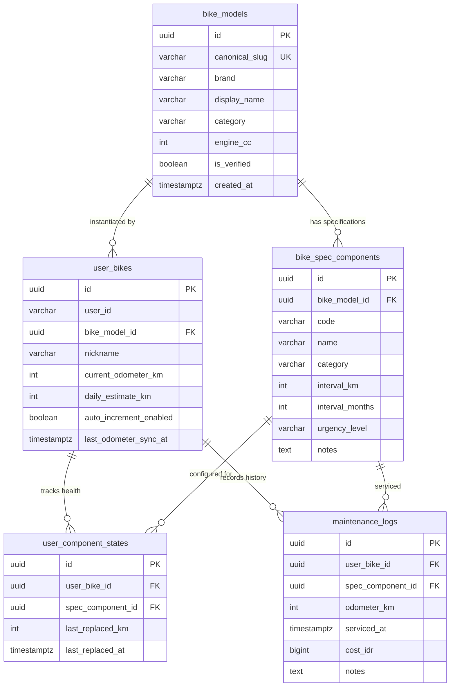

# MotoSpec 🏍️⚡

**MotoSpec** adalah platform pelacak spesifikasi dan pemeliharaan sepeda motor yang dirancang dengan standar *production-grade backend*. Aplikasi ini mendemonstrasikan orkestrasi LLM yang tangguh (*fault-tolerant* dengan *circuit breaker* dan *fallback routing*), *multi-layer read-through caching* (Redis + PostgreSQL + Singleflight), serta klien web *Progressive Web App* (PWA) yang *offline-first*.

---

## 🌟 Highlight Arsitektur

1. **Fault-Tolerant LLM Orchestrator:**
   - **Primary Provider:** Google Gemini API (JSON structured mode) dibungkus *circuit breaker* (`sony/gobreaker`) yang otomatis *trip* (Open) setelah 3 kegagalan beruntun dengan durasi *cooldown* 60 detik.
   - **Fallback Provider:** Groq / OpenAI-compatible endpoint dengan latensi ultra-rendah jika Primary mengalami *timeout* (4s), HTTP 5xx, atau gagal *domain sanity check*.
   - **Sanity Validation:** Memeriksa integritas JSON, validasi minimal 4 komponen wajib (termasuk `engine_oil`), rentang interval realistis (`interval_km >= 500`), dan pencegahan duplikasi *slug*.
   - **Outage Simulation Hook:** Header `X-Simulate-Outage: primary` untuk mendemonstrasikan *instant failover* secara deterministik pada pengujian dan demo portofolio.

2. **Multi-Layer Read-Through Cache & Singleflight:**
   - **Level 1 (Redis):** Cache spesifikasi deterministik (`spec:<canonical_slug>`) dengan TTL 24 jam untuk respon instan (< 5 ms).
   - **Level 2 (PostgreSQL 16):** Database relasional terindeks via `sqlc` dan driver performa tinggi `pgxpool`.
   - **Singleflight Barrier:** Mencegah fenomena *cache stampede* (*thundering herd*) saat beberapa pengguna mencari spesifikasi motor yang sama secara bersamaan ketika cache *miss*.

3. **Thin Client Mandate & Robust Domain Math:**
   - Seluruh perhitungan matematika keausan (*dual-trigger wear math*: $\max(\text{Wear}_{km}, \text{Wear}_{time})$ tanpa batas atas 100%), normalisasi *query/slug*, dan penentuan status (`healthy`, `warning`, `critical`, `unknown_needs_inspection`) dieksekusi secara eksklusif di backend Go (`internal/service`).
   - **Anti-Rollback Guarantee:** Validasi ketat odometer agar tidak bisa diturunkan.
   - **Atomic Batch Servicing:** Transaksi ACID (`ExecTx`) yang mereset baseline komponen sekaligus menaikkan odometer motor jika odometer servis lebih tinggi (`GREATEST(current_odometer_km, $2)`).
   - **Daily Auto-Increment Cron:** Worker terjadwal (`0 0 * * *`) untuk menambah jarak tempuh harian pengguna secara otomatis.

4. **Offline-Capable PWA Client:**
   - Dibangun dengan React 18, TypeScript (`"strict": true`), Vite, dan Tailwind CSS v4.
   - Caching runtime Workbox (`vite-plugin-pwa`) dan IndexedDB wrapper (`idb`) untuk menyimpan garasi motor secara lokal, memungkinkan akses penuh tanpa koneksi internet saat berada di bengkel.
   - **Portfolio Telemetry Drawer:** Panel inspeksi live yang menampilkan metadata latensi respon API (`meta.latency_ms`, `meta.source`), rasio hit cache, status sirkuit LLM, dan sakelar simulasi pemadaman primer.

---

## 🏛️ Diagram Alur Sistem (Spec Resolution Pipeline)

```mermaid
flowchart TD
    Client["PWA Client / API Consumer"] -->|GET /api/v1/specs/search?q=...| Router["Gin Router & Normalizer"]
    Router -->|Normalized Slug| SpecSvc["SpecService"]

    subgraph CachePipeline ["Multi-Layer Cache Pipeline"]
        SpecSvc -->|1. Check Cache| Redis[("Redis 7 Cache (L1)")]
        Redis -->|Cache Hit < 5ms| ReturnHit["Return Cached Spec"]
        Redis -.->|Cache Miss| PG[("PostgreSQL 16 (L2)")]
        PG -->|DB Hit ~20ms| BackfillRedis["Backfill Redis & Return"]
    end

    subgraph LLMOrchestration ["Fault-Tolerant LLM Orchestrator (Singleflight)"]
        PG -.->|DB Miss| Singleflight["golang.org/x/sync/singleflight"]
        Singleflight --> Breaker{"Circuit Breaker (gobreaker)"}
        Breaker -->|Closed| PrimaryLLM["Primary: Google Gemini (Timeout 4s)"]
        PrimaryLLM -->|Success & Sanity Passed| Persist["Persist to PostgreSQL & Set Redis"]
        PrimaryLLM -.->|Fail / Timeout / Open| FallbackLLM["Fallback: Groq / OpenAI (Timeout 4s)"]
        Breaker -->|Open (>3 Failures)| FallbackLLM
        FallbackLLM -->|Success & Sanity Passed| Persist
    end

    ReturnHit --> Response["JSON Response + Meta Envelope"]
    BackfillRedis --> Response
    Persist --> Response
    Response --> Client
```

---

## 🗄️ Entity Relationship Diagram (ERD)



---

## 📊 Perbandingan Performa & Mekanisme Failover

| Skenario | Sumber Data (`meta.source`) | Latensi Tipikal | Tingkat Ketersediaan | Mekanisme & Mitigasi Kegagalan |
| :--- | :--- | :--- | :--- | :--- |
| **L1: Cache Hit** | `redis_cache` | **< 5 ms** | 99.99% | In-memory key lookup, auto-eviction via TTL 24 jam. |
| **L2: DB Hit** | `postgres_db` | **15 – 30 ms** | 99.9% | Query terindeks via `canonical_slug`, otomatis backfill ke Redis. |
| **L3: LLM Primary** | `llm_primary` (Gemini) | **1.2 – 2.5 s** | 99.5% | Singleflight dedup; dibungkus context timeout 4s & circuit breaker. |
| **L3: LLM Fallback**| `llm_fallback` (Groq) | **800 – 1.5 s** | 99.9% | Otomatis aktif saat Primary timeout, HTTP 500, atau sirkuit terbuka. |
| **Simulated Outage**| `llm_fallback` | **800 – 1.5 s** | Deterministic | Hook `X-Simulate-Outage: primary` memotong panggilan primary. |
| **Bengkel Offline** | `indexeddb_offline` | **< 1 ms** | 100% (Local) | PWA Client fallback ke browser IndexedDB saat koneksi putus. |

---

## 🚀 Panduan Menjalankan Secara Lokal

### Prasyarat
- **Docker Desktop** (atau Docker Engine + Docker Compose)
- **Go 1.23+**
- **Node.js 20+** dan **npm**

---

### ⚡ Quick Start dengan Makefile
Bagi reviewer atau pengembang yang memiliki tool `make`:
```bash
make up       # Menjalankan PostgreSQL & Redis via Docker Compose
make backend  # Menjalankan backend Go (port 8080)
make web      # Menjalankan frontend Vite PWA (port 5173)
make test     # Menjalankan seluruh test backend & build frontend
make down     # Menghentikan service Docker Compose
```

---

### Langkah 1: Jalankan Infrastruktur (Docker Compose)
PostgreSQL dan Redis berjalan terisolasi di dalam container Docker. Port host PostgreSQL dipetakan ke `5433` untuk mencegah bentrokan dengan database PostgreSQL lokal di mesin host.

```powershell
docker compose up -d
```

Verifikasi kedua service berstatus *healthy*:
```powershell
docker compose ps
```

---

### Langkah 2: Konfigurasi Environment Backend & Frontend

1. **Backend:**
   Salin template `.env.example` ke `.env`:
   ```powershell
   copy backend\.env.example backend\.env
   ```
   *Catatan:* Jika Anda ingin menguji generasi LLM langsung (bukan simulated outage), masukkan `GEMINI_API_KEY` dan/atau `GROQ_API_KEY` pada file `backend/.env`.

2. **Frontend:**
   Salin template `.env.example` ke `.env`:
   ```powershell
   copy web\.env.example web\.env
   ```

---

### Langkah 3: Menjalankan Server Backend Go

Masuk ke direktori `backend` dan jalankan API:
```powershell
cd backend
go run cmd/api/main.go
```
Server akan aktif di `http://localhost:8080`.

---

### Langkah 4: Menjalankan Klien Frontend PWA

Buka terminal baru, masuk ke direktori `web`, pasang dependensi, lalu jalankan dev server Vite:
```powershell
cd web
npm install
npm run dev
```
Buka browser Anda di `http://localhost:5173`.

---

## 🧪 Pengujian & Verifikasi

### Menjalankan Unit Test Backend
```powershell
cd backend
go test -v ./...
```
*(Catatan: Pengujian `-race` penuh dijalankan secara otomatis pada Linux runner via GitHub Actions CI `.github/workflows/ci.yml`).*

### Memverifikasi Build Frontend PWA
```powershell
cd web
npm run build
```

---

## 📁 Struktur Repositori

```text
├── .agent/workflows/          # Standar verifikasi otomatis agent
├── .github/workflows/         # CI GitHub Actions (Go vet, unit tests, race detector)
├── docs/                      # Dokumentasi spesifikasi teknis & kontrak
│   ├── PRD.md                 # Product Requirement Document & wear formulas
│   ├── TECH_SPEC.md           # Desain teknis, cache pipeline, LLM resilience
│   ├── API_CONTRACT.md        # Spesifikasi REST API & error catalog
│   └── TASKS.md               # Tracking checklist fase implementasi
├── Makefile                   # Otomasi perintah cepat (up, backend, web, test, down)
├── backend/
│   ├── cmd/api/main.go        # Entrypoint server Go & graceful shutdown
│   ├── db/
│   │   ├── migrations/        # File migrasi SQL DDL (000001_init.up.sql)
│   │   ├── queries/           # File query sqlc (specs, garage, maintenance)
│   │   └── seeds/             # Seed data motor demo (001_demo_bikes.sql)
│   └── internal/
│       ├── handler/           # HTTP handlers & middleware Gin
│       ├── service/           # Domain math, normalizer, spec & garage logic
│       ├── llm/               # Primary/Fallback adapter, validator, gobreaker
│       ├── repository/        # Store wrapper, Redis cache, atomic telemetry
│       └── worker/            # Odometer daily cron worker
└── web/
    ├── public/                # Manifest & ikon PWA
    └── src/
        ├── api/               # Typed client & contract definition
        ├── components/        # Modals, cards, header, and telemetry drawer
        └── storage/           # IndexedDB offline garage wrapper
```

---

## 📄 Lisensi
Didistribusikan di bawah lisensi MIT. Dirancang khusus sebagai materi portofolio rekayasa perangkat lunak backend & sistem terdistribusi.
